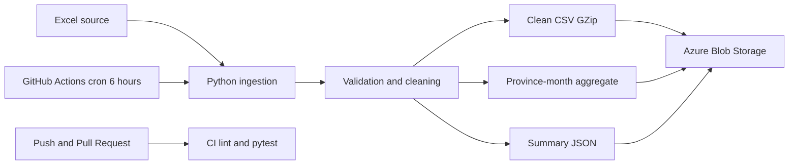

# Laporan Implementasi CI/CD Pipeline Data Supply Perumahan

**Kelas:** A  
**NIM:** L0224038  
**Nama:** Thufail Syarif Al Wafi

## 1. Tujuan

Proyek menerapkan ingestion data, pengujian otomatis, workflow terjadwal, dan
penyimpanan hasil pada Azure. Implementasi ini menunjukkan alur perubahan source
code melalui branch Git sampai merge serta pemisahan proses CI dan CD.

## 2. Dataset dan tema

Sumber data adalah `sup-001_data-supply-perumahan.xlsx`, sheet `Query result`.
Dataset berisi 274.823 observasi supply perumahan subsidi dan komersial dari 38
provinsi pada Juni 2020-November 2026. Terdapat 2.108 nilai asosiasi kosong; nilai
ini dinormalisasi menjadi `TIDAK_DIKETAHUI` agar baris tidak hilang.

## 3. Arsitektur

## 4. Pipeline ingestion

Modul `src/housing_pipeline/ingest.py` membaca Excel, memvalidasi 18 kolom wajib,
membersihkan teks, memeriksa angka negatif, menormalisasi tanggal ke awal bulan,
dan menghapus duplikat. Pipeline menghasilkan data bersih terkompresi, agregat
provinsi-bulan, dan ringkasan JSON.

## 5. Continuous Integration

`.github/workflows/ci.yaml` dipicu oleh push ke `main`/`feature/**` dan Pull
Request ke `main`. Job memasang Python 3.11, melakukan lint dengan Ruff,
menjalankan pytest, dan menyimpan JUnit XML sebagai artifact.

## 6. Git branch dan merge

Repository dimulai pada branch `main`. Pengembangan workflow, Azure Bicep, dan
peningkatan kualitas dibuat pada `feature/data-quality`, kemudian digabungkan ke
`main` memakai merge commit. `git log --graph --all` menjadi bukti riwayatnya.

## 7. Scheduler dan CD

`.github/workflows/scheduled-ingestion.yaml` memakai cron `0 */6 * * *`, yaitu
setiap enam jam dalam UTC. Workflow menjalankan pipeline penuh lalu mengunggah
hasil ke Azure Blob Storage menggunakan secret `AZURE_STORAGE_CONNECTION_STRING`.

## 8. Azure data store

`infra/main.bicep` membuat StorageV2 Standard LRS dan private Blob Container
`housing-results`. Public access dinonaktifkan, HTTPS/TLS 1.2 diwajibkan, serta
soft delete tujuh hari diaktifkan. Output dibagi menjadi path immutable
`runs/YYYY/MM/DD/HHMMSS/` dan salinan mutakhir pada `latest/`.

## 9. Keamanan

Kredensial tidak disimpan di Git. Connection string berada pada GitHub Actions
Secrets. Container bersifat private dan workflow hanya memperoleh izin baca
repository. Untuk implementasi produksi, federated OIDC dan Azure RBAC lebih
disarankan daripada connection string jangka panjang.

## 10. Kesimpulan

Implementasi memenuhi ingestion Python, CI berbasis branch/merge, workflow YAML,
scheduler enam jam, dan Azure data store. Pipeline dapat direproduksi secara lokal
dan dijalankan otomatis oleh GitHub Actions setelah secrets dikonfigurasi.
